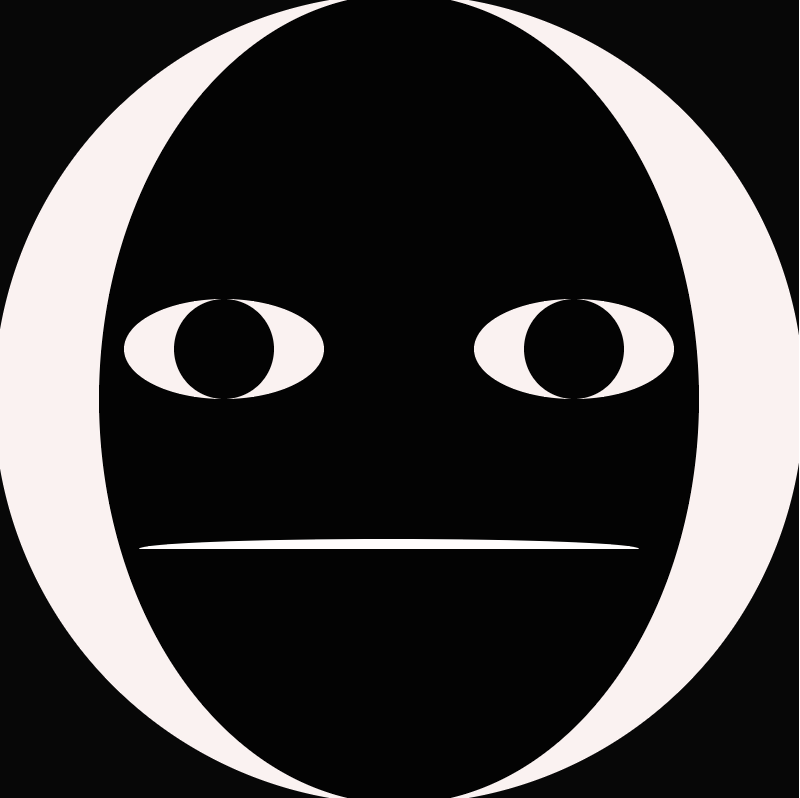
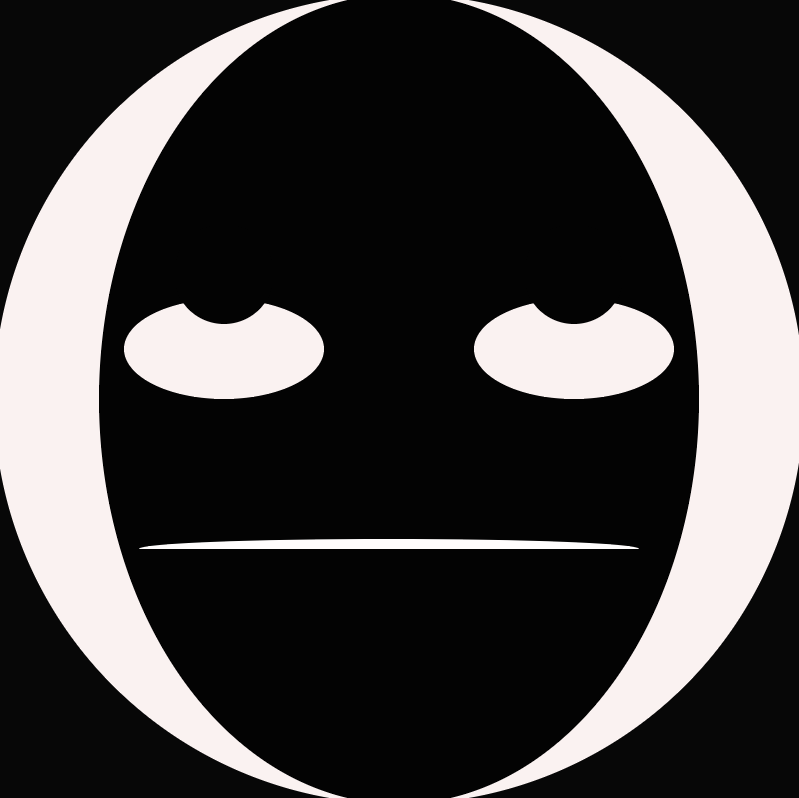
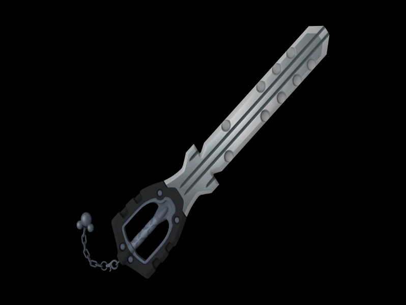
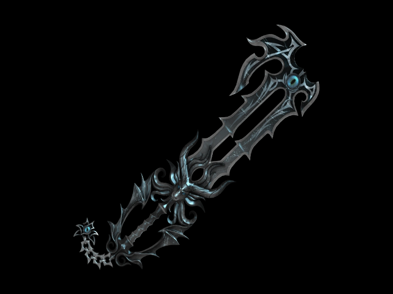
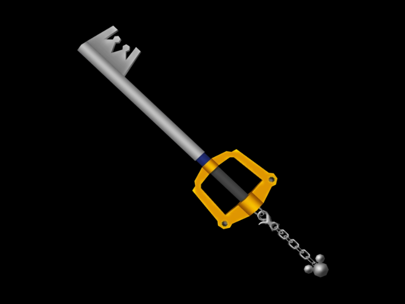
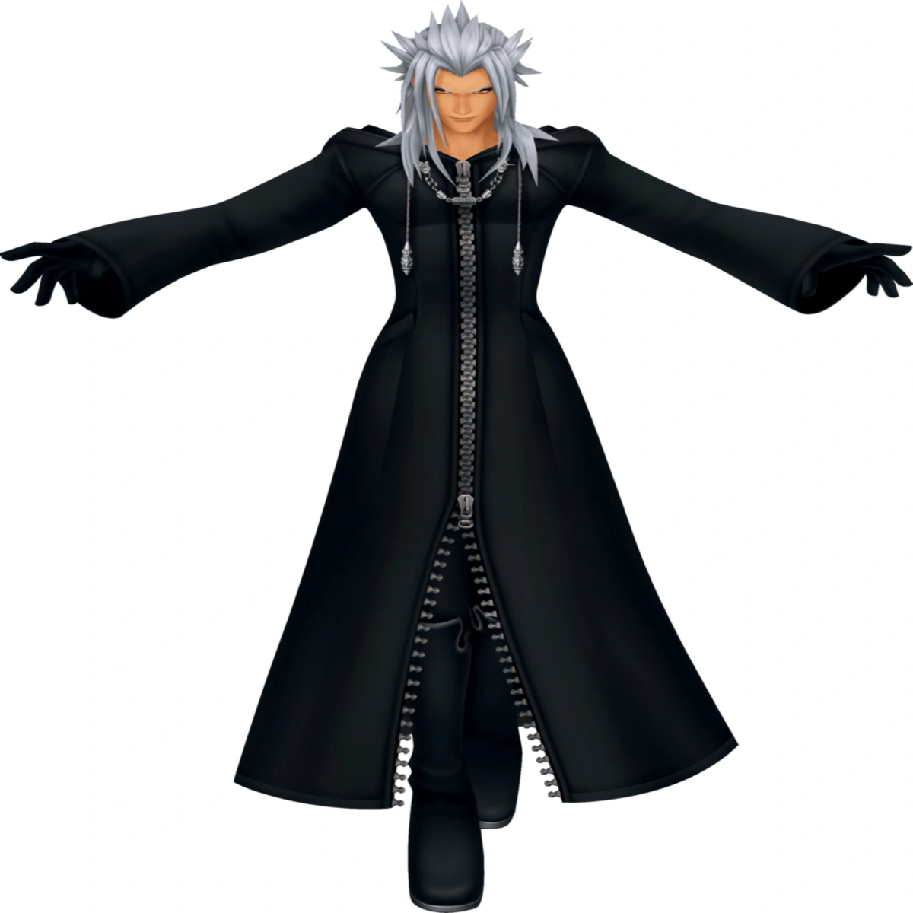
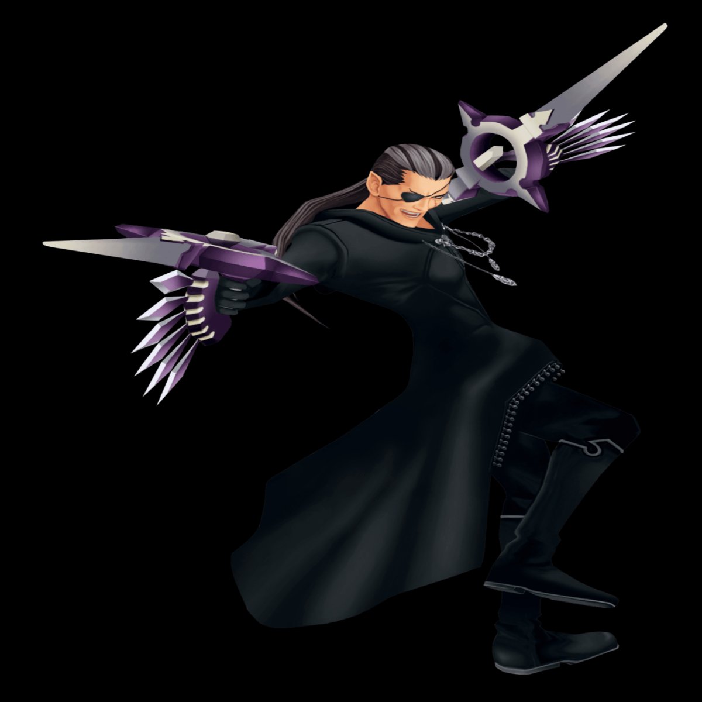
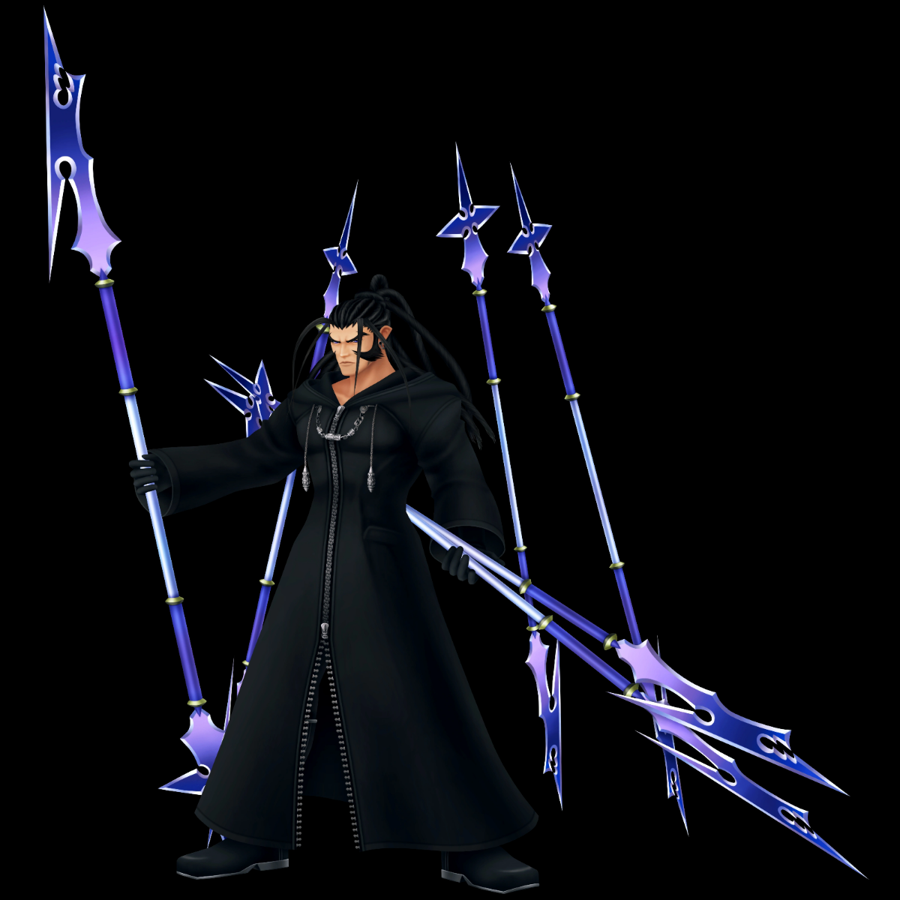
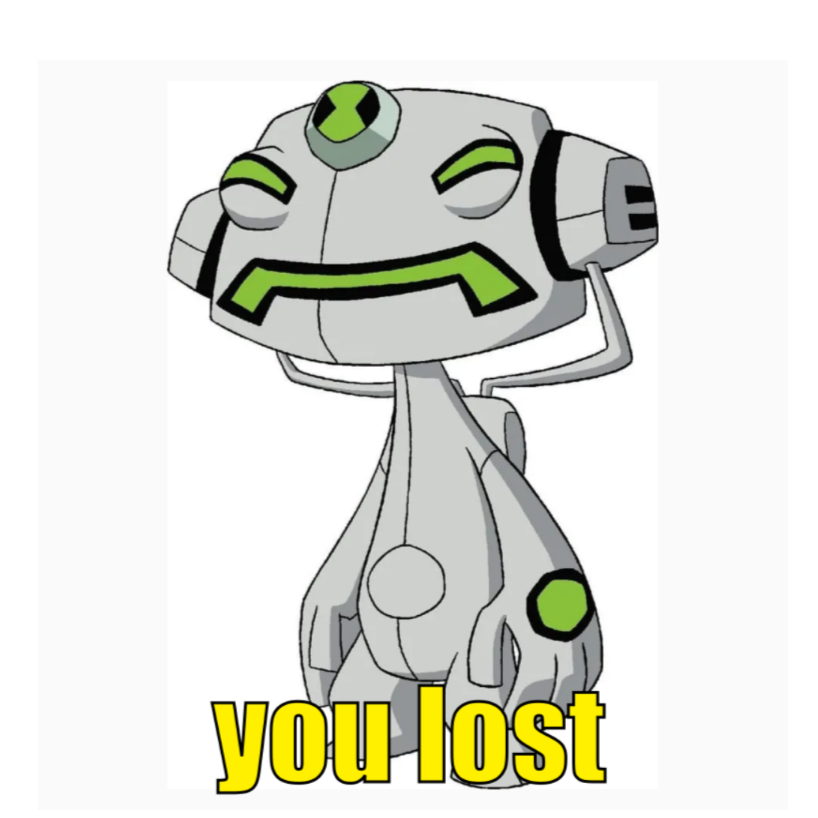
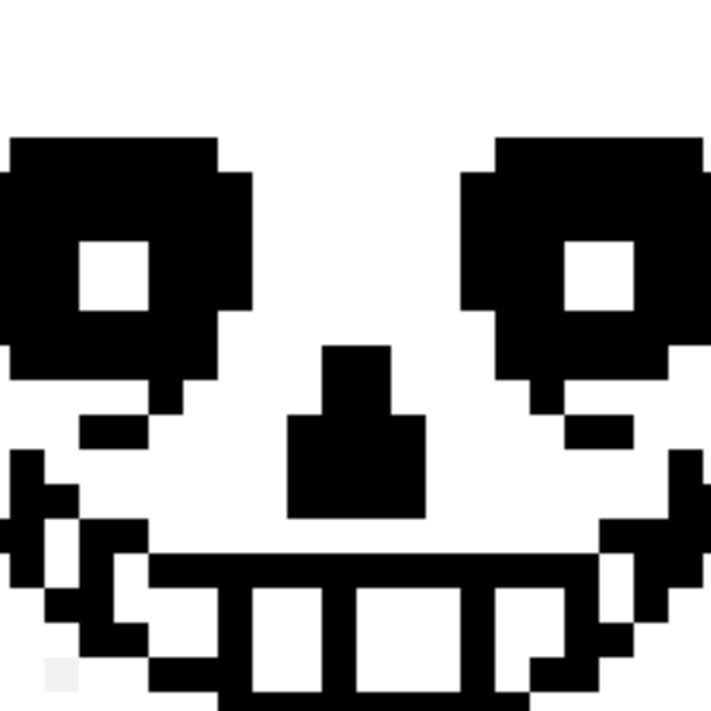

# Reflective journal
## September 12 2026
This went better than i was expected tbh. I was gonna take a random meme from google to use as a banner but then i realised that it was a bad idea and it was BORING! So i decided to DRAW MY OWN :D. The art is supposed to be silly so don't expect anything pretty. who am i kidding tho, you have already seen it so you can't EXPECT anything now.

Making this website with Markdown and Github was suprisingly easy? I was prepared for some rocket science that was gonna send me in severe spiraling existencial crisis but ay, i'm happy that it didn't :D. i'm still figuring out if i can add colors to the text...wait can i do that? let me check. OH I CAN! YES!

after looking at the page again i realised that the art was extremely horrible, also i have to make it match the new color palette so yeah, LET'S CHANGE THAT :D. oh and for reference, here's the old one:

  

i'm writing this journal to talk about my thought process but now that i think about it, my brain is EMPTY. Well what i'm writing rn is indeed my thoughts so i guess that works.

## September 16 2026

i decided to just stick with a simple text as a banner instead of a full on illustration, mainly because i couldn't figure out how to fit a text and characters in such a long composition. i also checked the web version of my repository, and i realised it was white, which basically made my text unreadable because of the colors i chose, so i changed the color in the index html, i couldn't find a way to do this in markdown so yeah.

after what it felt like HOURS (it was a like 30 minutes maximum tbh) of rotating between files and writing a buncha code THAT I HAD NO KNOWLEDGE OF. I was forced to go back to the boring black text D: The background REFUSED to change colors and i couldnt keep the purple, orange and yellowish green text since they were pretty hard to read on a white background, they did look good on the normal github repository tho. I'm sad but there isn't anything i can do about it so yeah. i tried to edit the index.html and style.css but that didn't work either, and it's getting late so i'll call it a day.

This wasn't as complicated as i thought it would be, mainly because i avoided any complicated stuff and sticked to the basics, i mean...idk how to code so yeah. Also for the future audience...i've got no idea how i want to make them feel, tbh i don't have a good grasp in what we will do in the future, but i would like to customize my github page to be more personal and less boring, seriously, i HATE mine rn. As for aspirations, well...i'm an artist not a web developper, i don't really have anyone to look up to for reference, tho i do have an HUGE intereset in ARGs and internet horror, mainly because i was obsessed with FNAF when i was a kid and really liked how the whole community was analyzing the website for clues, most of the hidden messages were hidden in the source code which back in the day was A GENIUS MOVE, but yeah, if i can develop an ARG that makes people feel scared and horrified, that would be pretty cool.

Here's some ugly website screenshots:

  

  

## September 23 2026

So i'm starting this at last minute, hopefully it will be simple and my brain wouldn't stop working...who am i kidding this is literally written after i've already finished.
it's actually 12:53 am rn so it isnt september 23 2026...it's the 24th, but i still haven't passed the deadline so i should be good :D.

##  September 24 2026

after finishing the three prototypes, I can say that i'm suprisingly happy with the results, aspecially considering the fact that i was working on them while being sleep deprived, food deprived AND WITH HUGE HEADACHE (literally). Anyways, I had fun with my time while making these three different prototypes.
I learnt how to make gradients this time! tho... i didn't use it because it just didn't work with what i was supposed to do, and that makes me a little dissapointed but ay, i'm happy. I also found it funny that some of the shapes that i put in my prototypes came from literal accidents, aspecially the third one with the creepy face, a typo caused the lizard sharp eyes and i wasn't going to include them in the original image. I was also cycling between three different variants:

  

  

  

before i ended up with the final one:

  

For the penguin one, It was the first thing that came up in mind, mainly because i love penguins...i mean who doesn't? It wasn't anything complicated and it was definetly the easiest out of the three. I tried to put lines on the ice floor like minecraft but that didn't work so...yeah.

  

For the moon, the main inspo was mejora's mask, I always liked how intimidating the moon was in that game, so i tried to replicate that but then i realised that it wasn't going to work out, so i switched to more silly tone.

  

Finally, i wanted to adress the progressive scale increase that you would probably notice when glancing at all three of these prototypes. No it was not intentional. I actually realised that the penguin canvas was way too small but i didn't want to redo it so i decided to include the concept of progressive scaling, that's it, nothing too deep, just an excuse for my laziness :p.

    
    
    

## September 28 2026

so i started on my first project with a simple idea. A JUMPSCARE!! I wanted to make an interactive canvas that jumpscared you when you clicked on it but...it didn't work, i still dont know why but for some reason the picture did not appear when someone clicked on the canvas. the click interaction worked because i tested it with a flat red color, so there is a problem from the image loading itself. I tried different things to solve the problem but it didn't work so i gave up.

## september 30/ october 1 2026

so late night programming session, YAAAAAY! i dont like working in mornings so this is perfect for me. the first prototype was pretty simple, i was inspired by mr furious (mainly because of the circle changing colors), so i decided to make a sunset. Unlike mr furious, i had to learn how to program the color to shift from one color to another, not one value to another, which i was able to do. after that i programmed the sun's movement and added some mountains, pretty normal stuff.

the next one was a clock. And i had no idea how to do this. I was only familiar with translation movements, so radial ones were pretty much a foreign concept for me. So you probably know what time it is...LEARNING TIME. so at first it was simple, just draw shapes and put their variables on the top. the main problem was the clock hands movement and the numbers alignement. I learnt how to alling the numbers, which wasnt so difficult and also used variables if i remember correctly. the clock hands on the other hand were kind of confusing because i had no idea how to move them in a radial move, so...i had to learn it! and that i did, this relied heavily on variables and angles and all that complicated stuff, also appparently the clock keeps on moving even when you leave the page? maybe im mistaken tho.

the last one is my favorite, NOT BECAUSE IT INVOLVES GAMBLING! well...you cant really call it gambling if there is no money involved...right? anyways, out of all the three, this one was the most complicated because it relied on randomizers and constants, two things that i have no idea about, after looking them up things were a little simple, tho i have a feeling that i might forget how to do this after a week...or 2 days. anyways, i used the same mouse click interraction that i learnt in my first scrapped jumpscare project, so i guess that didnt go to waste... but yeah, after a very confusing session of looking at stuff that looked like hyroglephics...i didn't spell it correctly right? who cares. this turned out to be my favourite!

so i learnt alot of things from these three prototypes, before, i didnt really use variables which limited me alot and made the organization of my code a living nightmare, so im thankful for this experience, THANK YOU FOR READING :D

    
    
    

## october 5 2026 / october 7 2026

So, last time, I understood that my descriptions of what i was doing made me come off as uncertain or doing stuff that i didn't know, so this time, i'll try to be more descriptive.

For the first prototype, I decided to expand on the shape generator prototype, but this time, I put my favourite game in the mix, KINGDOM HEARTS!! i started by looking at the one of the projects that were showcased in class (the loot drops one), i used the probability code as a base and then moved from there by adding a mouse press interaction, it didnt work at first and it was already late so i took a break. 

So, i came back to finish the first prototype, after adding the mouse press interaction that allowed the program to pull an image from the number of images that i have already loaded. i was thinking about adding sound, but apparently, there's restrictions that dont allow sound to be played unless you click on something first, so i decided to scrap the idea.

    
    
    

For the second one, i used the "screen wrap project" as inspiration, but instead of a random moving circle, i wanted to make falling snowflakes. I started by looking at the code to imitate the movement of the pink circle, changing it's velocity to make it drop from top to bottom. after that i used conditionals to randomize the velocity, making the snow fall down more naturally. but now...i needed to figure out how to make the program generate snow so it doesnt stop. So while working on this, i realised that i had to override the whole snowflake (white circle), i still kept the main values, and the velocity randomizer stayed the same, i just edited it so it generated snowflakes, using conditionals.

  

I spent some time making sure that i have commented on every line of code.

This last one was actually the one that enjoyed the most, I did a basic code where rarity (from my little pony) avoids the cursor who is also spike, the cursor change idea was actually something i thought of after finishing the main cursor avoidant mechanic, which was pretty simple, it reminded me alot of the two overlapping circles that we saw in class, since both use the distance as a reference to know when to avoid or lean away from the cursor. But yeah, this was alot more simple than the other two, since it only required me to replace the cursor, load an image, and use conditionals for the distance calculating aspect. Still, this one is definetly my favourite from the three.

  

## october 21 2026

so i just realised that i got a 0 in the previous prototype assignement, apparently the links weren't working, but when i checked them, they worked completely fine. pretty sure this was just a missunderstanding. ANYWAYS, this is just a rant to start documenting my prototype programming process.

so, for the first one, it was a simple cute idea where i wanted to make an interactive page where you waked up a cat from their peaceful slumber. i chose this idea cuz it was an easy one to program duh. I did face some challenges tho. the first part was programming the interaction (using mouse pressed), which wasn't anything new, however i wanted to add more immersion, so i wanted to make it so the cat went back to sleep after 10 seconds, i did that by using millis. i thought that everything was fine until i noticed that this only worked once, because after that, the cat refused to wake up (it woke up for a split second), i realised that this happened because i was missing a line of code, so i added it! and now that im writing this, i realised that i didnt comment on my code, so lemme do that real quick.

next prototype also had a cat, why? idk, i like cats. this one was different tho. i wanted to jumpscare people, the main plan was to use the prototype that we did in class (in groups) as a point of reference. The idea was simple, a cat is begging you to stay, but what if you don't? that's when you get jumpscared. the coding for this was pretty simple since i took code from the challenge that we did in our studio time, i was thinking about adding a creepy sound to set the tone but i realised that i would have to loop it and that would probably sound awkward.

for the final one, i tried to make it cat themed too. So i made a game! the idea was simple, you're a cat who's following a yarn ball. I used one of the projects that we saw in class as reference here (the coin collector one), and this one was by far the easiest, since i basically had a point of reference that i could go back to whenever i got stuck. I added a cat image as a cursor which looked pretty cute, and after i added the yarn ball i realised that it had a watermark on it, i couldnt find a better picture on google tho so i had to stick with it. now that i think about it, i can just turn the background to white instead of black and the watermark would be hidden, oh wow im a genius, lemme do that real quick. anyways after finishing the whole game, i decided to added a sound effect that played when you collected a yarn ball, but of course, i couldnt just add a normal cute cat meow, i had to find an......interesting one, and that i did! anyways this was definetly my favourite and i enjoyed making these alot!
please regrade my previous assignement, it was a missunderstanding, my links were always working :<.

    
    
    

## october 28 2026
So on this day, i was only able to think of my first idea. i love kingdom hearts, so i decided to make an organization XIII prototype. It only has three of the members right now but i'll try to find the others (i need to find they're voice lines). anyways i started the prototype but i didn't get anything significant done mainly because my anxiety kicked in. DO NOT WORRY everything is fine, it's just my brain doing brain stuff.

## october 29 2026
I went back to finish my prototype at arround 9 am, the goal was to do as much as possible before 1:15, but i was only able to get one prototype done.
i was able to add three of the members, and made it so when you type their number "1, 2 or 3" they appear.

    
    
    

 I tried to add all the other members but that caused the whole program to break, this was due to the fact that i was missing some audio files for some of the members. so i decided to remove them, but i do plan to add them eventually.
after i finished the class, i told Pipin that i was gonna finish all the prototypes before the deadline...that didnt happen. BUT I COULDNT HELP IT, my anxiety episode started to kick in again and i was unable to do ANYTHING. matter of fact i had to go outside and visit my family so i would feel better. so yeah no prototypes were done that day :D.

## october 30 2026
Okay this day was pretty good, i'm actually writing all of the things that you read on this day. Apparently, visiting my family was just what i needed, so that's good. i started with my second prototype, which was an omnitrix...well, it was more like a velgax battle simulator. every single time you  click on the omnitrix, you transform to an alien, but most of them lose to velgax, because i made it like that. the only one who wins against him is alien X because he's cool. fun fact, the text that is displayed isnt programmed, i edited the images and added text to them, mainly because that's the way that i was comfortable with,and also because i wanted to avoid coding it :p.

  

for the next prototype, it was heavily inspired by Pippin's stamp program. the concept was simple, every single time you click on the canvas, sans appears. Things looked  pretty simple so i decided to make sans grow bigger the more you clicked on the canvas. i also added his iconic text sound effect to make things more interesting.

  

anyways i had fun making these prototypes (even tho this week wasnt the best)
and i appologize once again for the late submission, i know that you told us to notify you if we were gonna submit late, but as you can see, everything that happened was unnexpected.
